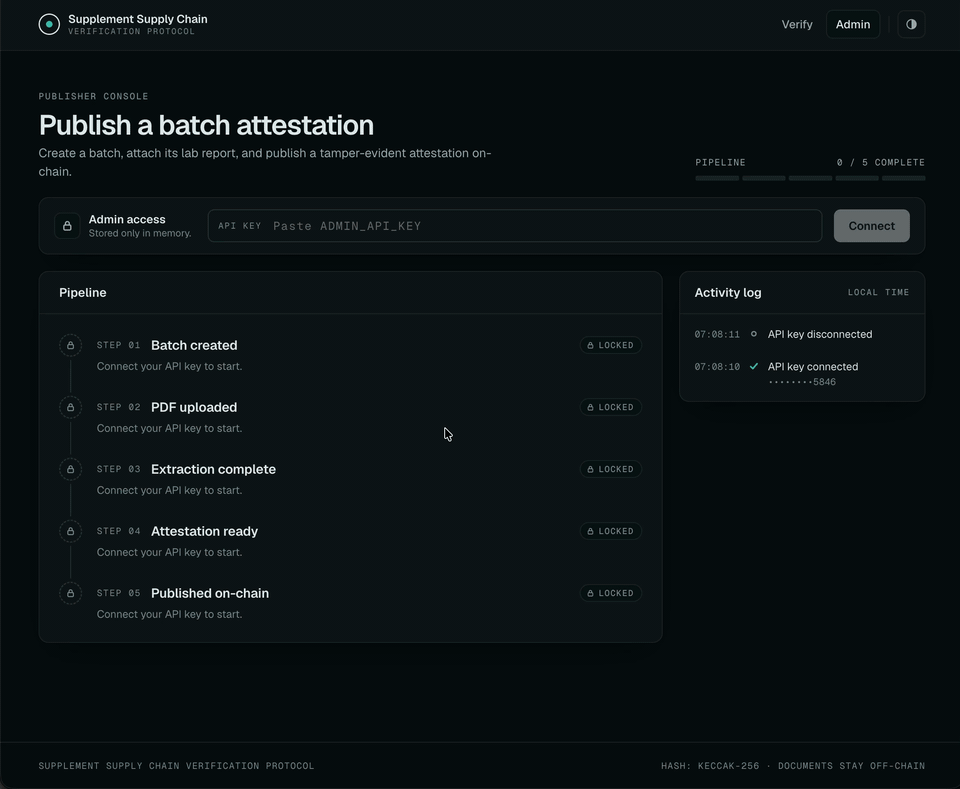

# Supplement Supply Chain Verification Protocol

## Demo Video



## Problem Statement

The supplement industry faces significant challenges with product authenticity, quality verification,
and supply chain transparency. Consumers and retailers lack reliable ways to verify that supplement
batches meet claimed specifications and originate from legitimate sources. Lab reports and certificates
of analysis (COAs) are often difficult to access, verify, or may be falsified.

This system enables supplement manufacturers and distributors to publish tamper-evident attestations
about batch quality and origin. By storing only cryptographic hashes on-chain (not full documents), we
maintain privacy while ensuring data integrity.

## User Roles

### Admin/Publisher
- Manufacturers: Companies that produce supplement batches
- Distributors: Entities that handle supplement distribution
- Responsibilities:
  - Upload lab report PDFs for supplement batches
  - Publish attestations linking batch IDs to document hashes
  - Manage batch metadata (product name, batch number, production date, etc.)

### Consumer
- End consumers: Individuals purchasing supplements
- Retailers: Stores selling supplements to consumers
- Responsibilities:
  - Verify supplement batches by batch ID
  - View extracted lab report data (off-chain)
  - Verify attestation integrity

## Core User Flows

### 1. Publish Attestation Flow (Publisher)
1. Publisher uploads a lab report PDF for a supplement batch
2. System extracts key data from PDF using AI (batch ID, product name, test results, etc.)
3. System generates a cryptographic hash of the PDF document
4. Publisher reviews extracted data and confirms
5. System publishes an attestation containing:
   - Batch ID
   - Document hash
   - Timestamp
   - Publisher address
6. System stores full document and extracted data off-chain in database

### 2. Verify Batch Flow (Consumer)
1. Consumer enters a batch ID (e.g., from supplement packaging)
2. System queries the attestation registry for the batch ID
3. System retrieves off-chain document hash from database
4. System verifies that on-chain hash matches off-chain hash
5. Consumer views extracted lab report data (test results, ingredients, etc.)
6. System displays verification status (verified/unverified/not found)

## What Is On-Chain vs Off-Chain

### On-Chain (Attestation Registry)
- Batch attestations: Minimal registry entries containing:
  - Batch ID reference (Keccak-256 of the batch ID)
  - Attestation fingerprint (Keccak-256 of the canonical attestation JSON, which includes the PDF's SHA-256 fingerprint)
  - Publisher address (who attested)
  - Timestamp (when attested)
- Purpose: Tamper-evident proof that a specific batch was attested at a specific time by a specific entity

### Off-Chain (Database)
- Full lab report PDFs: Original documents
- Extracted data: AI-parsed information (ingredients, test results, dates, etc.)
- Metadata: Product names, batch numbers, production dates, publisher info
- Purpose: Efficient storage and retrieval of detailed information without bloating the chain

## Tech Stack

### Frontend
- Framework: Next.js (React + TypeScript)
- Styling: Custom CSS (global styles)

### Backend
- Runtime: Python + FastAPI
- API: OpenAPI/Swagger specification
- Database: PostgreSQL (SQLite for local/dev)

### AI/ML
- PDF processing and extraction via server-side pipeline
- LLM provider configurable; mock provider for deterministic tests, demo provider (offline rule-based parser) for local demos with the sample COA in `backend/tests/fixtures/sample_coa.pdf`

### Blockchain
- Network: **Base** (Ethereum L2); **Base Sepolia** testnet by default. EVM-compatible, so the
  Solidity registry and web3.py client run unchanged, with sub-cent fees and Basescan for public proof.
- Presets for `base`, `base-sepolia`, `ethereum`, `sepolia` and `initia-evm` (`CHAIN_NETWORK`).
- Mock mode (`CHAIN_MODE=mock`) mirrors the contract's rules, produces realistic block numbers for
  the selected network, and persists sealed records to `backend/mock_chain.json` across restarts.

### DevOps
- Containerization: Docker + Docker Compose
- Testing: pytest

## Quick start (local)

1) Copy `.env.example` to `.env` and set `ADMIN_API_KEY`.
2) Start the stack: `docker compose up --build`.
3) Open http://localhost:3000/admin and paste `ADMIN_API_KEY` from `.env`.


## Backend + Frontend (Docker)

1) Copy `.env.example` to `.env` and fill values:

```bash
cp .env.example .env
```

2) Build and start services:

```bash
docker compose up --build
```

- Frontend: http://localhost:3000
- Backend: http://localhost:8000
- Admin UI: http://localhost:3000/admin (use `ADMIN_API_KEY` from `.env`)
- Docker Compose runs with `CHAIN_NETWORK=base-sepolia`, `CHAIN_MODE=mock` and `LLM_PROVIDER=demo` by default.

## Backend + Frontend (without Docker)

Backend (Python 3.11+):

```bash
cd backend
python3 -m venv .venv && source .venv/bin/activate
python3 -m pip install -r requirements-dev.txt
cp .env.example .env            # set ADMIN_API_KEY; CHAIN_MODE=mock needs no RPC or keys
LLM_PROVIDER=demo python3 -m uvicorn app.main:app --reload --port 8000
```

Frontend (Node 20+), in a second terminal:

```bash
cd frontend
npm ci
cp .env.example .env.local      # NEXT_PUBLIC_API_BASE_URL=http://localhost:8000
npm run dev
```

Open http://localhost:3000/admin, connect with your `ADMIN_API_KEY`, and use "sample certificate (PDF)"
in the upload step to run the whole flow. Sealed batches persist in `backend/mock_chain.json`.

## Tests

### Backend unit tests

```bash
cd backend
python3 -m pytest
```

### Backend integration tests (Docker)

Start Docker first:

```bash
docker compose up --build -d
```

Then run:

```bash
cd backend
INTEGRATION_BASE_URL=http://localhost:8000 \
INTEGRATION_API_KEY=$ADMIN_API_KEY \
python3 -m pytest integration_tests
```

INTEGRATION_API_KEY defaults to `ADMIN_API_KEY` from the root `.env`.

Or use the helper script (reads `ADMIN_API_KEY` from `./.env` if set):

```bash
./backend/scripts/run_integration_tests.sh
```

## Live Demo

- Frontend URL:
- Backend URL:
- Contract address:
- Chain RPC:

## How to deploy

Block-explorer links (transactions and the registry contract) come from the backend's network
preset via `GET /chain/info`, so the frontend needs no chain configuration.

See `DEPLOYMENT.md` for the recommended deployment steps.

## CI/CD

### CI (GitHub Actions)
- Runs backend unit tests (`pytest`) with `LLM_PROVIDER=mock`, `CHAIN_MODE=mock`, and SQLite.
- Runs frontend build (`npm run build`) and lint (`npm run lint`).
- Runs integration tests via Docker Compose (builds stack, waits for health, executes `backend/scripts/run_integration_tests.sh`).

Run locally with the same commands:

```bash
# Backend unit tests
cd backend
LLM_PROVIDER=mock CHAIN_MODE=mock DATABASE_URL=sqlite:///./app.db python3 -m pytest

# Frontend build + lint
cd frontend
npm ci
npm run build
npm run lint

# Integration tests (Docker)
cd ..
cp .env.example .env
docker compose up -d --build
./backend/scripts/run_integration_tests.sh
docker compose down -v
```

### CD (GitHub Actions)
The CD workflow is a placeholder and will be filled in with provider-specific steps. Expected secrets:
- `DEPLOY_TOKEN`: deployment authentication token
- `BACKEND_DEPLOY_TARGET`: backend deployment target/identifier
- `FRONTEND_DEPLOY_TARGET`: frontend deployment target/identifier
